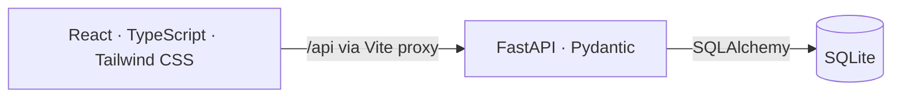

# Common Ground · 交流廣場
> 1151自由選修 結合 Vibe Coding 之 Python FastAPI Web 服務開發

A full-stack bulletin board for sharing time-limited posts and discussing them with other members.

[繁體中文](README.zh-TW.md) · [Features](#features) · [Quick start](#quick-start) · [Administration](#administration) · [Architecture](#architecture) · [Development and tests](#development-and-tests)

## Features

| Area | What you can do |
| --- | --- |
| Public board | Browse, search, and paginate active posts. Sort by newest or most replies. |
| Member accounts | Register, sign in, update your profile and password, and view your own posts. |
| Posts and discussions | Create, edit, and delete your own posts. Reply to active posts and toggle likes. |
| Administration | View activity statistics and system status, manage members and posts, remove replies, reset member passwords, and review audit logs. |

Posts expire after seven days by default. Expired posts drop out of the public feed and stop accepting new replies or likes.

## Quick start

Install Git, Python 3.11 or later, and Node.js with npm. The Windows setup was verified with Python 3.12 and Node.js 24. Open PowerShell and run these commands.

```powershell
git clone --branch bulletin-board https://github.com/YuDe0418/fastapi-vibe-coding-project.git
cd fastapi-vibe-coding-project
python -m venv .venv
powershell -ExecutionPolicy Bypass -File .\start-dev.ps1 -Install
```

The script installs dependencies, generates `backend/.env` with a local signing key, and starts both services. FastAPI creates `backend/data/board.db` on startup. Register on the board to create a member account, or use the CLI below to create an administrator.

| Service | Local URL |
| --- | --- |
| Bulletin board | <http://localhost:5173> |
| Admin dashboard | <http://localhost:5173/admin> |
| Interactive API docs | <http://localhost:8000/docs> |
| API health check | <http://localhost:8000/health> |

Use `localhost` consistently when browsing the default setup so the session cookie stays on the same hostname. On subsequent runs, omit `-Install`. The following command stops both services.

```powershell
powershell -ExecutionPolicy Bypass -File .\stop-dev.ps1
```

If the default ports are occupied, pass `-BackendPort 8001 -FrontendPort 5174` to the start script and open <http://127.0.0.1:5174>. The script prints the active URLs, and service logs are written to `data/dev-logs/`.

### Start the services manually

From the project root, run the backend in one terminal. After creating `.venv`, activate it with `source .venv/bin/activate` on macOS/Linux or `.\.venv\Scripts\Activate.ps1` in PowerShell.

```sh
python -m venv .venv
# Activate .venv using the command above before continuing.
python -m pip install -r backend/requirements.txt
cd backend
python -m app.core.init_env
python -m uvicorn app.main:app --reload --host 127.0.0.1 --port 8000
```

In a second terminal at the project root, start the frontend. Use `npm.cmd` in PowerShell.

```sh
cd frontend
npm ci
npm run dev
```

## Administration

From the project root on Windows, run the following command and enter the password twice when prompted.

```powershell
Push-Location backend
try {
    & ..\.venv\Scripts\python.exe -m app.core.create_admin --username admin --email admin@example.com
} finally {
    Pop-Location
}
```

With an activated virtual environment, run `python -m app.core.create_admin --username admin --email admin@example.com` from `backend/` on any platform. Sign in as `admin` and open the dashboard. To reset that account's password, run `python -m app.core.reset_admin --username admin` from the same directory and environment.

## Architecture



The frontend sends requests to `/api` on the same origin. Vite forwards them to FastAPI in development. FastAPI checks member and administrator permissions and uses a JWT stored in an HTTP-only cookie for the session.

| Path | Role |
| --- | --- |
| [`frontend/src/`](frontend/src/) | Public board, member pages, and admin dashboard |
| [`backend/app/api/`](backend/app/api/) | REST endpoints and authorization dependencies |
| [`backend/app/models/`](backend/app/models/) | SQLAlchemy models for members, posts, replies, likes, pins, and audit logs |
| [`backend/app/core/`](backend/app/core/) | Configuration, authentication, and local admin and demo commands |
| [`backend/tests/`](backend/tests/) | Backend integration tests and a local smoke test |

## Development and tests

Run these commands from the project root with the Python virtual environment activated and frontend dependencies installed. Use `npm.cmd` in PowerShell.

```sh
python -m pytest -c backend/pytest.ini backend/tests -q
npm --prefix frontend run test
npm --prefix frontend run build
```

The build runs TypeScript checks and writes the frontend bundle to `frontend/dist/`. See [`.env.example`](backend/.env.example) for the backend settings, including `DATABASE_URL`, `COOKIE_SECURE`, `TOKEN_MINUTES`, and `ALLOWED_ORIGINS`.

To populate a local SQLite database after the first startup, run `python -m app.core.seed_demo` from `backend/` with the virtual environment activated. The command creates sample accounts and posts and writes generated credentials under `backend/data/` with the default database path.
