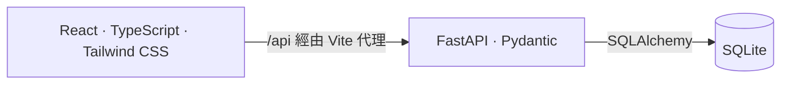

# Common Ground · 交流廣場

一個全端留言板，讓使用者發布有期限的貼文，並與其他會員交流。

[English](README.md) · [主要功能](#主要功能) · [快速開始](#快速開始) · [管理後台](#管理後台) · [系統架構](#系統架構) · [開發與測試](#開發與測試)

## 主要功能

| 區域 | 可以做什麼 |
| --- | --- |
| 公開看板 | 瀏覽、搜尋有效貼文，支援分頁，可依最新發文或最多回覆排序。 |
| 會員帳號 | 註冊、登入、修改個人資料與密碼，以及查看自己的貼文。 |
| 貼文與討論 | 新增、編輯與刪除自己的貼文，回覆有效貼文，並按讚或取消讚。 |
| 管理後台 | 查看統計及系統狀態、管理會員與貼文、刪除回覆、重設會員密碼，以及查閱操作紀錄。 |

貼文預設七天後到期。到期後，貼文會從公開列表移除，並停止接受新回覆與新讚。

## 快速開始

先安裝 Git、Python 3.11 以上和 Node.js（含 npm）。Windows 啟動流程使用 Python 3.12 與 Node.js 24 驗證。開啟 PowerShell 執行下列指令。

```powershell
git clone --branch bulletin-board https://github.com/YuDe0418/fastapi-vibe-coding-project.git
cd fastapi-vibe-coding-project
python -m venv .venv
powershell -ExecutionPolicy Bypass -File .\start-dev.ps1 -Install
```

腳本會安裝套件、產生含本機簽章金鑰的 `backend/.env`，並啟動前後端。FastAPI 啟動時會建立 `backend/data/board.db`。一般會員可直接在網站註冊，管理員帳號可透過下方指令建立。

| 用途 | 本機網址 |
| --- | --- |
| 留言板 | <http://localhost:5173> |
| 管理後台 | <http://localhost:5173/admin> |
| 互動式 API 文件 | <http://localhost:8000/docs> |
| API 健康檢查 | <http://localhost:8000/health> |

使用預設設定時，請固定以 `localhost` 瀏覽網站，讓登入 Cookie 使用同一個主機名稱。日後啟動可以省略 `-Install`。下列指令會停止前後端服務。

```powershell
powershell -ExecutionPolicy Bypass -File .\stop-dev.ps1
```

若預設埠號已被占用，可以在啟動指令加入 `-BackendPort 8001 -FrontendPort 5174`，再開啟 <http://127.0.0.1:5174>。腳本會印出啟動網址，服務日誌位於 `data/dev-logs/`。

### 手動啟動前後端

在專案根目錄開啟一個終端機啟動後端。建立 `.venv` 後，在 macOS/Linux 用 `source .venv/bin/activate` 啟用它，在 PowerShell 則用 `.\.venv\Scripts\Activate.ps1`。

```sh
python -m venv .venv
# 先用上方對應的指令啟用 .venv，再執行下方指令。
python -m pip install -r backend/requirements.txt
cd backend
python -m app.core.init_env
python -m uvicorn app.main:app --reload --host 127.0.0.1 --port 8000
```

另外在專案根目錄開啟一個終端機啟動前端。在 PowerShell 中請使用 `npm.cmd`。

```sh
cd frontend
npm ci
npm run dev
```

## 管理後台

在 Windows 的專案根目錄執行下列指令，並依提示輸入兩次密碼。

```powershell
Push-Location backend
try {
    & ..\.venv\Scripts\python.exe -m app.core.create_admin --username admin --email admin@example.com
} finally {
    Pop-Location
}
```

如果已啟用虛擬環境，可在任何平台的 `backend/` 目錄執行 `python -m app.core.create_admin --username admin --email admin@example.com`。建立後以 `admin` 登入並開啟管理後台。若要重設這個帳號的密碼，在相同目錄與環境執行 `python -m app.core.reset_admin --username admin`。

## 系統架構



前端以同源的 `/api` 路徑發送請求，開發時由 Vite 轉送到 FastAPI。後端檢查會員與管理員權限，登入狀態使用存於 HTTP-only Cookie 的 JWT。

| 路徑 | 用途 |
| --- | --- |
| [`frontend/src/`](frontend/src/) | 公開看板、會員頁面與管理後台 |
| [`backend/app/api/`](backend/app/api/) | REST API 路由與權限檢查 |
| [`backend/app/models/`](backend/app/models/) | 會員、貼文、回覆、按讚、置頂與操作紀錄的 SQLAlchemy 模型 |
| [`backend/app/core/`](backend/app/core/) | 後端設定、身分驗證，以及本機管理與示範指令 |
| [`backend/tests/`](backend/tests/) | 後端整合測試與本機冒煙測試 |

## 開發與測試

啟用 Python 虛擬環境並安裝前端套件後，在專案根目錄執行下列指令。在 PowerShell 中請使用 `npm.cmd`。

```sh
python -m pytest -c backend/pytest.ini backend/tests -q
npm --prefix frontend run test
npm --prefix frontend run build
```

前端建置會執行 TypeScript 型別檢查，並將成品寫入 `frontend/dist/`。後端設定範例請見 [`.env.example`](backend/.env.example)，其中包含 `DATABASE_URL`、`COOKIE_SECURE`、`TOKEN_MINUTES` 與 `ALLOWED_ORIGINS`。

如需在本機 SQLite 資料庫加入示範資料，請先啟動網站一次，再於 `backend/` 目錄啟用虛擬環境並執行 `python -m app.core.seed_demo`。指令會建立示範帳號與貼文，使用預設資料庫路徑時，產生的登入資料會儲存在 `backend/data/`。
